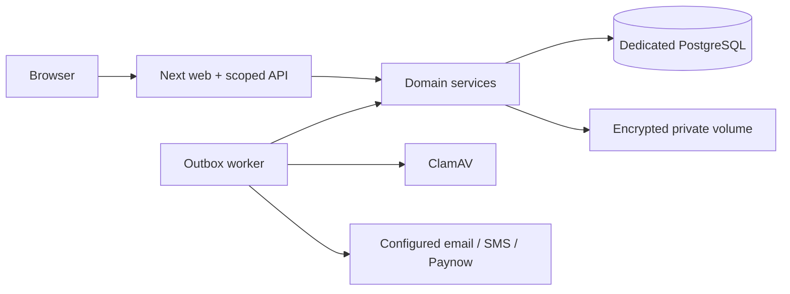

# Legacy Heights

The original client Word scope is now preserved and audited across **141 substantive items** in [the completeness audit](docs/audit/ORIGINAL_SCOPE_COMPLETENESS.md). Latest verification: [scope audit evidence](docs/QA/SCOPE_AUDIT_EVIDENCE.md).

A dedicated accommodation platform for student and private residents: public catalogue, bed-level dated reservations, resident portal, property-scoped staff workspaces, KYC quarantine/review, finance, signed-upload leases, support, and integration exchange.

**Development implementation, not an approved production deployment.** All supplied inventory and people are synthetic. External merchant, messaging and legal approvals are not invented. See [implementation status](docs/IMPLEMENTATION_STATUS.md), [scope traceability](docs/audit/LEGACY_SCOPE_TRACEABILITY_MATRIX.md), and [release evidence](docs/QA/RELEASE_EVIDENCE.md).

## Repository boundaries

This is `seanshairah/legacy-housing`. The existing `Student-housing-management-` repository is read-only reference material. No source code or branded assets were copied. [Boundary evidence](docs/REPOSITORY_BOUNDARY.md).

## Run locally

Requires Node 24, npm, Docker and an available local PostgreSQL port. From this checkout:

```sh
./scripts/setup-local.sh
npm run demo:journey          # optional, synthetic end-to-end resident fixture
npm run dev -- --port 3001
# In another terminal:
npm run worker
```

The setup script preserves existing `.env` and local data, creates dedicated `legacy_dev` and `legacy_test` databases, deploys migrations, installs frozen dependencies and creates nonproduction fixtures. It starts a loopback-only PostgreSQL service and ClamAV. Wait for `docker logs legacy-scanner` to show `clamd started` before uploading. The current cloud machine reuses its existing local PostgreSQL container, but never reads or migrates the reference application's databases. Do not run an existing script in the reference checkout.

Open the public catalogue, then sign in through `/auth`. Local fixture email addresses and randomly generated passwords are stored only in ignored, mode-0600 `.data/demo-credentials.json`. Staff must use the MFA tab with their password to enroll an authenticator, confirm its code, then sign in with a current code. No default production administrator exists. `scripts/bootstrap.ts` creates the first property/admin only from an already email/mobile-verified, MFA-enabled account; it refuses a second bootstrap.

Pages: `/`, `/rooms`, `/auth`, `/portal`, `/workspace/overview`, and separate admissions/inventory/KYC/finance/leases/operations/integrations/reports/security/settings workspaces. Every command checks authorization in a shared domain service.

## Validate

```sh
npm run typecheck
npm run lint
npm run format:check
DATABASE_URL=postgresql://postgres@127.0.0.1:5432/legacy_test npm test
DATABASE_URL=postgresql://postgres@127.0.0.1:5432/legacy_test npm run test:e2e
npm run build
npm audit --audit-level=high
```

Browser tests require Chromium (`CHROMIUM_PATH`, default `/usr/bin/chromium`) and run a separate server on port 3002 against `legacy_test`. Stop your dev server before the browser suite; Next permits only one dev server per output directory. Tests insert uniquely named synthetic fixtures; they refuse another database name. They do not delete settled financial/audit records. Recreate only the disposable test database when resetting fixtures. Never direct tests at a remote database. CI uses an ephemeral PostgreSQL service and real ClamAV.

## Architecture

Next 16 / React 19 / TypeScript, Prisma 6 and PostgreSQL 16. Domain modules live under `src/domain`; web routes and UI call the same services. A separate PostgreSQL outbox worker handles expiry, waitlists, billing, reminders, malware scanning and delivery retries. Financial values use integer minor units; corrections append records. PostgreSQL constraints prevent overlapping bed/resident allocations and mutation of issued financial/lease evidence. Files use authenticated AES-256-GCM encryption on a private volume, never the public directory.



Configuration: `DATABASE_URL`, `APP_URL`, independent 32-byte hexadecimal `DATA_KEY`, `FILE_KEY`, `BACKUP_KEY`, storage root, scanner host/port. `LOCAL_DEMO=true` permits fixture preparation only outside production on `legacy_dev`. `PAYNOW_MODE=disabled` blocks gateway initiation; live mode requires real integration ID/key, verified merchant currency and public HTTPS application URL. Optional Resend/SMS Pop keys enable real delivery; missing providers generate retry/dead-letter records, never fake successful sends. See [.env.example](.env.example) and [integrations](docs/INTEGRATIONS.md).

`deepmerge-ts` is overridden to patched 8.0.2 for Prisma CLI security. Client generation, migrations, tests and build validate compatibility. No package checksums or TLS verification are bypassed.

## Containers and operations

`docker compose up --build` defines web, worker, database, scanner and daily encrypted backups. Configure `.env`, local DB password and all encryption keys first. The image build and isolated container health/database startup were tested locally. A fresh local Compose stack also passed startup, page/health and encrypted-backup checks; acceptance on the selected production host remains a release gate. In cloud environments where the platform proxy hostname is injected into the host, `node --import tsx scripts/build-cloud.ts` preserves the same proxy route and CA trust inside BuildKit; it does not bypass network policy. It does not seed real properties or create an administrator automatically. Scanner signatures require maintenance/network access. Add the supplied Caddy reverse-proxy configuration, DNS, certificate issuance, managed secrets and external backup storage for production.

See [runbook](docs/ops/RUNBOOK.md) for migration, rollback, backup/restore, monitoring, outages and key rotation; [user guides](docs/USER_GUIDES/README.md) for role workflows; [client decisions](docs/CLIENT_DECISIONS.md) for required real-world inputs.

Native electronic lease signing uses verified contacts, an authenticator, a one-use document-bound review and an approved versioned disclosure. The exact scanned signed PDF and immutable evidence remain subject to independent execution review. Blank disclosures keep manual signing. Production browser checks can be run after `npm run build` with `LEGACY_E2E_PRODUCTION=true` and the loopback `legacy_test` DATABASE_URL override. Security signals and reviews are in the scoped staff security workspace; the scheduled weekly security workflow complements production host intrusion monitoring.
