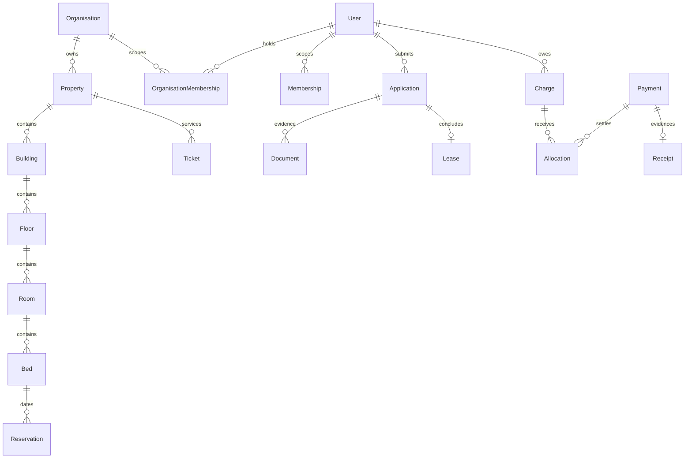

# Domain model

All sensitive domain changes produce AuditEvent and OutboxEvent in the same transaction. Roles grant capabilities within a property; resident ownership is checked separately. Executed lease evidence and financial postings use restrictive relations and immutable-record triggers. Reservation states HOLD→CONFIRMED→ACTIVE→ENDED; expiry/cancel release inventory, maintenance blocks overlap. Application, KYC, payment and lease states remain separate.

The original-scope completion migration adds LeaseSigningChallenge (lease/user/hash-bound, expiring one-use review; unique consumed user/TOTP step) and SecurityAlert (hourly deduplicated hashed subject, severity/count/state and reviewer evidence). LeaseTemplate.signingDisclosure is copied into the immutable issued source; generated scanned signed-document metadata, consumed challenge, lease REVIEW and signature audit/evidence commit atomically. An issued lease source cannot be rewritten even before execution. Tenancy-condition consent stores the exact current published content hash/version and rejects stale submissions.

The 29 October organisation foundation adds required Property.organisationId, OrganisationMembership and explicit PlatformGrant. An organisation grant never implicitly replaces property capabilities. Restricted tenant transactions use transaction-local user/organisation settings plus a non-bypass RLS role; relational guards prevent cross-property foreign-key substitution. Existing global identity/worker control-plane operations require separate privileges and shared-mode integration remains a release gate.

AccountInvitation stores a hashed expiring single-use staff invitation bound to email/property/role and inviter. MFA recovery codes use hashed Challenge records with a distinct purpose. RetentionPolicy versions, DocumentLegalHold and DocumentDeletion record approved policy, independent approval, hold/release and deletion outcome; Document retains its immutable hash/version and deletion tombstone. General document disposal excludes signed-agreement/payment evidence and never cascades through financial/audit history.
