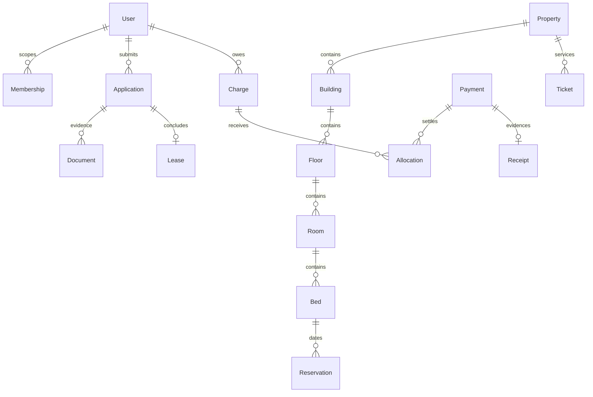

# Domain model

All sensitive domain changes produce AuditEvent and OutboxEvent in the same transaction. Roles grant capabilities within a property; resident ownership is checked separately. Executed lease evidence and financial postings use restrictive relations and immutable-record triggers. Reservation states HOLD→CONFIRMED→ACTIVE→ENDED; expiry/cancel release inventory, maintenance blocks overlap. Application, KYC, payment and lease states remain separate.
