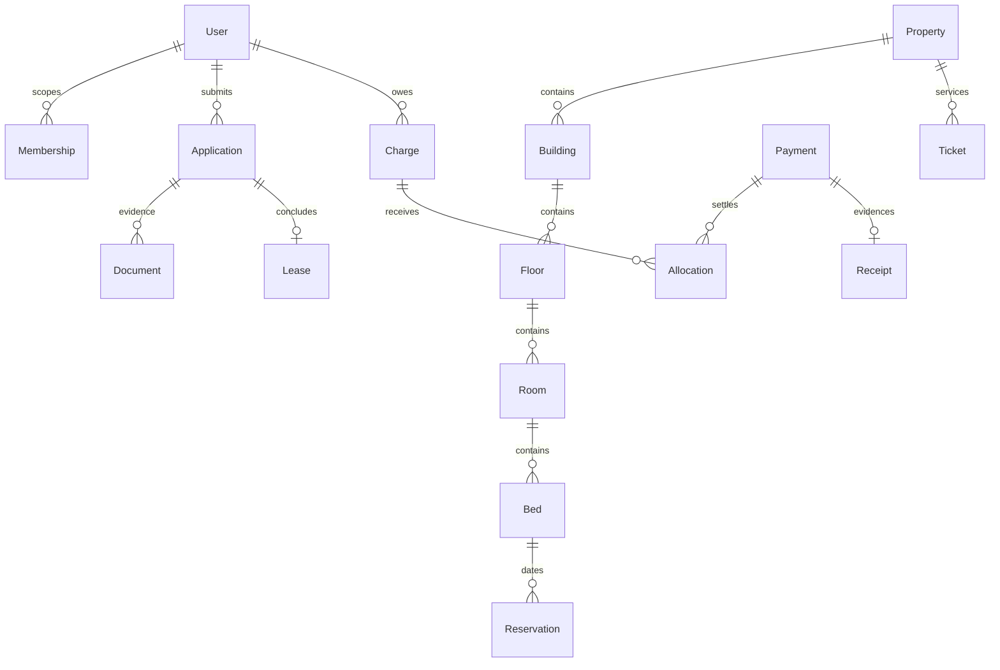

# Domain model

All sensitive domain changes produce AuditEvent and OutboxEvent in the same transaction. Roles grant capabilities within a property; resident ownership is checked separately. Executed lease evidence and financial postings use restrictive relations and immutable-record triggers. Reservation states HOLD→CONFIRMED→ACTIVE→ENDED; expiry/cancel release inventory, maintenance blocks overlap. Application, KYC, payment and lease states remain separate.

The original-scope completion migration adds LeaseSigningChallenge (lease/user/hash-bound, expiring one-use review; unique consumed user/TOTP step) and SecurityAlert (hourly deduplicated hashed subject, severity/count/state and reviewer evidence). LeaseTemplate.signingDisclosure is copied into the immutable issued source; generated scanned signed-document metadata, consumed challenge, lease REVIEW and signature audit/evidence commit atomically. An issued lease source cannot be rewritten even before execution. Tenancy-condition consent stores the exact current published content hash/version and rejects stale submissions.
